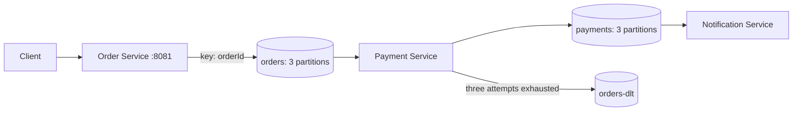
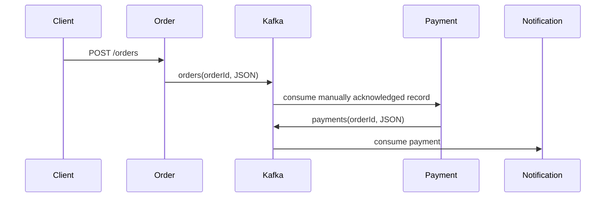
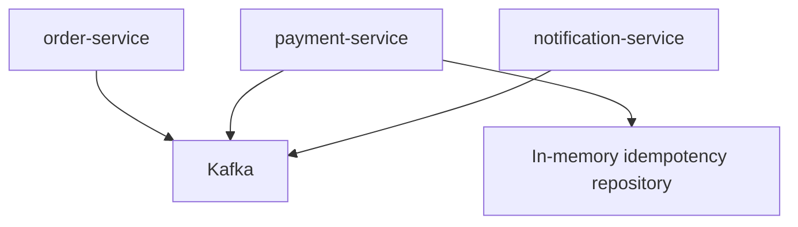

# Kafka Order Processing Pipeline

A production-style Java 21 and Spring Boot 3 Kafka demonstration for the flow `POST /orders → orders → payment-service → payments → notification-service`.

## Architecture




## Run
```bash
docker compose up -d
mvn clean install
mvn -pl order-service spring-boot:run
mvn -pl payment-service spring-boot:run
mvn -pl notification-service spring-boot:run
```
Kafka UI is at http://localhost:8080. Topics are `orders`, `payments`, retry topics, and `orders-dlt`.

Create an order:
```bash
curl -X POST http://localhost:8081/orders -H "Content-Type: application/json" -d '{"customerId":"customer-1","amount":49.99,"simulateFailure":false}'
```
Set `simulateFailure` to `true` to observe three delivery attempts and DLQ consumption.

## Kafka behavior
`orderId` is the Kafka key, so all events for one order are assigned to the same partition; Kafka preserves order within that partition. Payment consumers use the `payment-service` group to divide partitions safely. Offsets are manually acknowledged only after processing. A `ConcurrentHashMap` claims order IDs to prevent duplicate payment processing. Retry topics provide at-least-once delivery and the DLT preserves exhausted records for investigation.

Kafka producer idempotence and transactions can provide exactly-once Kafka read-process-write semantics when configured with a transactional producer; this sample intentionally uses idempotent business processing because external payment gateways require their own idempotency keys.

## Testing
Run `mvn test`. Unit tests cover controller/service behavior and consumer acknowledgment paths. Extend with Testcontainers for CI integration tests.

## Expected logs
`received_order`, `kafka_produced`, `payment_started`, `payment_success`, `retry_attempt`, `dlq_published`, and `notification_sent` are emitted as key-value SLF4J messages.

## Component diagram


## Screenshots
Add Kafka UI topic and consumer-group screenshots here.

## Future improvements
Use a shared event contract module, schema registry, transactional outbox, persistent idempotency storage, OpenTelemetry, Testcontainers, and Kubernetes manifests.
